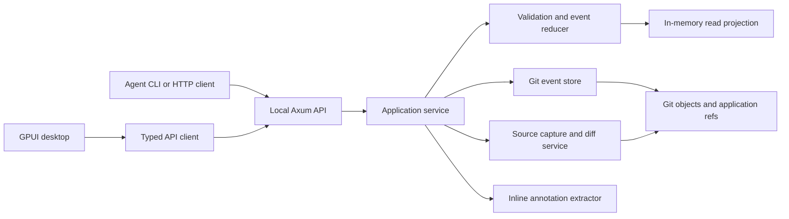

# Rev Queue design

Status: proposed implementation design, based on the agreed product direction.

## 1. Purpose

Rev Queue is a local tool for reviewing agent work toward a goal. Agents submit
small, coherent units of change called **thunks**. A reviewer sees a dependency-aware
queue, inspects code, makes edits, and leaves feedback without leaving the review
editor. Publishing delivers a complete round of feedback to the agent. The agent
can then replace thunks, withdraw obsolete work, and submit new work.

Every thunk is immutable. There is no separate thunk revision entity: a replacement
is another thunk with a new ID and an explicit link to its predecessor. History is
append-only, including review decisions and restores. Earlier code and review
states remain recoverable.

The first version uses a Rust backend, a native GPUI frontend, shared Rust protocol
types, and Git as the authoritative persistence layer. SQLite is unnecessary for
the initial implementation. A future search index may use SQLite, but must be
rebuildable entirely from Git.

## 2. Product decisions and boundaries

| Area | Decision |
| --- | --- |
| Scope | One local source repository per backend instance; multiple goals |
| Review unit | One coherent thunk, potentially spanning multiple files |
| Source workflow | Agent works in a dedicated goal worktree; submissions capture explicit source trees |
| History | Git commits record application transactions on private application refs |
| Replacement | New immutable thunk with `supersedes`; no revision table |
| Dependencies | Directed acyclic graph between exact thunk IDs |
| Feedback | Durable drafts, explicitly published immutable batches |
| Inline instructions | Language-aware `#!` review comments, extracted on publication |
| Reviewer edits | Isolated editable snapshot, captured as an exact patch |
| Approval | Review acknowledgment for one exact thunk; does not merge or apply code |
| Restore | Append a restore event selecting an earlier active state; preserve intervening history |
| Agent delivery | Durable polling and acknowledgment, with optional live notifications |
| UI | GPUI desktop application; backend remains usable without it |

Initial non-goals: remote collaboration, automatic merge into a user's branch,
multiple source repositories inside one goal, arbitrary language editor parity,
and automatically executing agent-supplied validation commands.

## 3. Architecture



The daemon owns durable writes. The frontend and agents use the same command/query
boundary. GPUI-specific types stay out of domain and protocol models. Blocking Git
subprocesses and parsing run outside GPUI's UI thread and outside Tokio's async
worker threads, using a bounded worker pool or `spawn_blocking`.

Proposed workspace:

```text
crates/
  revqueue-model/       IDs, domain records, commands, query DTOs, errors; serde
  revqueue-core/        validation, reducer, graph logic, queue derivation
  revqueue-git/         subprocess adapter, object encoding, CAS ref updates
  revqueue-review/      annotation extraction, source maps, diff anchoring
  revqueue-server/      Axum routes, writer service, subscriptions
  revqueue-client/      typed async client shared by desktop and CLI
  revqueue-desktop/     GPUI entities, editor, views, actions
  revqueue-cli/         agent-facing commands and machine-readable output
```

Start with modules if crate overhead slows implementation; preserve these
dependency boundaries. Rename the existing `persistance` module to `persistence`
when implementing the store. The existing incomplete structs and route are a
prototype, not a compatibility contract.

## 4. Three independent graphs

1. **Event order:** the parent chain of application commits records transactions.
2. **Replacement lineage:** `new.supersedes = old.id` means another attempt at the
   same reviewable intent. Iteration is derived from this chain.
3. **Dependencies:** `B depends_on A` means B was built against the exact intent
   and implementation represented by A.

Source ancestry is separate again: each thunk has an exact before/after tree.
Neither a Git commit parent nor sharing a file implies a review dependency.

`related_to` is an informational association and never causes invalidation.
Reject hard dependency cycles. Mutually inseparable changes should be one thunk.
In v1, dependencies and replacements stay within a goal.

Only one member of a replacement lineage can be current in the active goal state.
Replacing a non-current member is a conflict, including after a restore. Splitting
or combining changes uses a transaction that withdraws the old current thunks and
submits new independent thunks with provenance links; it does not invent ambiguous
multi-parent iteration numbers.

## 5. Shared primitives and serialization

The Rust snippets below specify the intended model, not a standalone compilable
module. Public records derive `Clone`, `Debug`, `Serialize`, and `Deserialize`;
IDs additionally derive equality, ordering, and hashing. Command inputs have
constructors/validation rather than trusting successful deserialization.

```rust
// Each is a distinct newtype, serialized as a UUID string.
id_types!(RepositoryId, GoalId, ThunkId, EventId, ActorId, DraftId,
          FeedbackId, BatchId, CheckpointId, CommandId, ValidationId);

struct GitOid(String);       // validated hex; supports repository object format
struct RepoPath(String);     // normalized UTF-8 repository-relative path in v1
struct Timestamp(String);    // UTC RFC 3339, assigned by server
struct Epoch(u64);           // instructions/work generation; never decreases
struct Sequence(u64);        // transaction number within a goal; never decreases
struct ByteOffset(u64);      // UTF-8 byte position, not character/display column

struct GoalVersion {
    head: GitOid,            // application history commit, optimistic concurrency
    sequence: Sequence,
    epoch: Epoch,
}

struct Actor {
    id: ActorId,
    kind: ActorKind,         // Reviewer | Agent | System
    display_name: String,
}

struct SourceSnapshot {
    tree: GitOid,            // Git tree, not an application commit
}

struct TextRange {
    start: ByteOffset,
    end: ByteOffset,         // half-open; validated against the source blob
}
```

Wire enums use explicit `snake_case` tags. Persist a schema version on every
transaction and major record format. Deterministic JSON uses stable field encoding
and sorted map keys (`BTreeMap`); no floating-point values in persisted records.
Use integer confidence basis points, rejecting values above 10,000. IDs do not
encode ordering; sequence numbers do.

V1 rejects non-UTF-8 filenames with an actionable error instead of lossy conversion.
Reject absolute paths, parent traversal, NULs, and traversal through symlinks.
Source blobs preserve original bytes, file modes, and newline conventions.

## 6. Backend domain records

### 6.1 Goals and thunks

```rust
struct Goal {
    id: GoalId,
    repository: RepositoryId,
    title: String,
    objective: String,
    base: SourceSnapshot,
    created_by: ActorId,
    created_at: Timestamp,
}

struct Confidence {
    basis_points: u16,       // 0..=10_000
    rationale: String,
}

struct Thunk {
    id: ThunkId,
    goal_id: GoalId,
    author: ActorId,
    created_at: Timestamp,
    based_on_epoch: Epoch,
    title: String,
    description: String,
    supersedes: Option<ThunkId>,
    iteration: u32,          // server checks: root=1, replacement=previous+1
    depends_on: Vec<ThunkId>,
    related_to: Vec<ThunkId>,
    provenance: Vec<ThunkId>, // optional history for splits/combined work
    before: SourceSnapshot,
    after: SourceSnapshot,
    confidence: Confidence,
    validation: Vec<ValidationEvidence>,
    responds_to: Vec<FeedbackId>,
}

struct ValidationEvidence {
    id: ValidationId,
    source: SourceSnapshot,
    reported_by: ActorId,
    command_display: String,
    outcome: ValidationOutcome, // Passed | Failed | NotRun
    output_blob: Option<GitOid>,
    recorded_at: Timestamp,
}
```

Evidence is a report, not proof of approval. Distinguish agent-reported evidence
from a future locally executed validation service. Never execute `command_display`
just because a submission includes it.

The diff of `before` and `after` is exactly what this thunk asks the reviewer to
inspect. It must not include unrelated dirty work. Capture uses an explicit file
allowlist and a stable workspace revision or a patch against a known tree. Prefer
patch submission or capture from a paused agent worktree to avoid mixed snapshots
while files are being written.

A tree can include prerequisite code without putting that code in the thunk's own
diff. The backend checks that declared prerequisites can compose with the before
tree. Overlapping/conflicting patches require explicit reconciliation, not an
assumption that the newest whole tree represents the combined goal.

### 6.2 Anchored feedback and reviewer edits

```rust
enum FeedbackTarget {
    Goal { goal_id: GoalId },
    Thunk { thunk_id: ThunkId },
    Code { thunk_id: ThunkId, anchor: CodeAnchor },
}

struct CodeAnchor {
    snapshot: SourceSnapshot,
    path: RepoPath,
    blob: GitOid,
    side: DiffSide,          // Before | After
    range: TextRange,
    context_before: String,
    selected_text: String,
    context_after: String,
}

struct Feedback {
    id: FeedbackId,
    author: ActorId,
    target: FeedbackTarget,
    body: String,
    kind: FeedbackKind,      // Question | ChangeRequest | Note
    origin: FeedbackOrigin,  // Sidebar | Inline { draft_id, source_range }
}

struct ReviewerEdit {
    thunk_id: ThunkId,
    base: SourceSnapshot,
    edited: SourceSnapshot,  // annotation-free result
    annotated: SourceSnapshot,
    source_map_blob: GitOid,
}

enum ImpactScope {
    Selected { thunks: Vec<ThunkId> },
    GoalWide,
}

struct FeedbackBatch {
    id: BatchId,
    goal_id: GoalId,
    author: ActorId,
    reviewed_at: GoalVersion,
    epoch_before: Epoch,
    epoch_after: Epoch,
    message: String,
    feedback: Vec<Feedback>,
    edits: Vec<ReviewerEdit>,
    scope: ImpactScope,
    invalidation_roots: Vec<ThunkId>,
    stale_thunks: Vec<ThunkId>, // server-computed closure, frozen at publication
    consumed_drafts: Vec<DraftEditionRef>,
    published_at: Timestamp,
}
```

Anchors refer to immutable source, never only a mutable file's line numbers.
Display line/column values are derived from blob bytes. After edits, reattachment
can be exact, context-matched, ambiguous, or orphaned. Keep the original anchor and
show ambiguity; never silently move feedback to an unrelated line.

The agent's `responds_to` links propose that feedback was addressed. Only a reviewer
resolution event closes a change request. Agent acknowledgment of a batch means
receipt, not completion.

### 6.3 Drafts

```rust
struct ReviewDraft {
    id: DraftId,
    goal_id: GoalId,
    reviewer: ActorId,
    edition: u64,
    opened_at: GoalVersion,
    thunk_id: Option<ThunkId>, // None permits goal-level draft feedback
    base: Option<SourceSnapshot>,
    annotated: Option<SourceSnapshot>,
    sidebar_feedback: Vec<Feedback>,
    marker_intents: Vec<MarkerIntent>,
    updated_at: Timestamp,
}

struct DraftEditionRef { draft_id: DraftId, edition: u64 }
struct MarkerIntent { path: RepoPath, range: TextRange, enabled: bool }
```

Draft saves append new editions. The projection identifies the latest edition;
older editions remain recoverable. Debounce saves, but flush before publish or
closing a review. Show unsaved/saving/saved/error states; a crash can lose the
unsaved debounce window, never a confirmed save. Discarding a draft is an event.

Goal transactions contain draft updates too. This gives durable autosave without
a second database or cross-ref publish transaction. Draft events are private to
the reviewer in normal agent queries and are never agent instructions before
publication. Local storage is not an isolation boundary against other processes
with repository access.

### 6.4 Events and derived state

```rust
struct Transaction {
    schema_version: u32,
    command_id: CommandId,
    request_digest: String,
    goal_id: GoalId,
    sequence: Sequence,
    actor: ActorId,
    at: Timestamp,
    events: Vec<EventRecord>,
}

struct EventRecord { id: EventId, payload: Event }

enum Event {
    GoalCreated { goal: Goal },
    ThunkSubmitted { thunk: Thunk },
    ThunkWithdrawn { thunk_id: ThunkId, reason: String },
    DraftSaved { draft: ReviewDraft },
    DraftDiscarded { draft_id: DraftId },
    FeedbackPublished { batch: FeedbackBatch },
    DecisionRecorded { thunk_id: ThunkId, decision: ReviewDecision },
    FeedbackResolved { feedback_id: FeedbackId, resolution: String },
    BatchAcknowledged { batch_id: BatchId, agent: ActorId },
    CheckpointCreated { checkpoint: Checkpoint },
    GoalRestored { restore: RestoreRecord },
    GoalClosed { reason: String },
}

enum ReviewDecision { Approved, ChangesRequested { reason: String } }

struct GoalProjection {
    goal: Goal,
    sequence: Sequence,
    epoch: Epoch,
    closed: bool,
    thunks: BTreeMap<ThunkId, Thunk>,
    current_thunks: BTreeSet<ThunkId>,
    reviews: BTreeMap<ThunkId, ThunkReviewState>,
    drafts: BTreeMap<DraftId, ReviewDraft>,
    published_batches: BTreeMap<BatchId, FeedbackBatch>,
    resolved_feedback: BTreeSet<FeedbackId>,
    acknowledgments: BTreeSet<(BatchId, ActorId)>,
    checkpoints: BTreeMap<CheckpointId, Checkpoint>,
    reverse_dependencies: BTreeMap<ThunkId, BTreeSet<ThunkId>>,
}

struct ThunkReviewState {
    decision: Option<ReviewDecision>,
    stale_causes: Vec<StaleCause>,
    withdrawn: bool,
}

enum StaleCause {
    Feedback { batch_id: BatchId },
    ReplacedDependency { old: ThunkId, replacement: ThunkId },
    WithdrawnDependency { thunk_id: ThunkId },
}
```

The pure reducer applies transactions deterministically. IDs, timestamps, graph
closures, and other nondeterministic inputs are fixed before persistence. Replay
does not consult the current filesystem or clock.

Review state has independent dimensions: an approved thunk can later become
stale. Preserve its approval record but block its use until reconciled. A
replacement always starts without approval. Revalidating stale work creates a
new thunk, even if its before/after trees are unchanged; it explicitly states the
new dependencies, epoch, and validation.

## 7. Queue behavior and invalidation

The active queue includes current, non-withdrawn thunks. Display prerequisites
before dependents using a stable topological order; break ties by submission
sequence then thunk ID. Review can inspect any item; dependencies do not prevent
reading code. Approval is blocked when prerequisites are stale, withdrawn, or not
approved. Stale items remain visible in a needs-reconciliation group.

Confidence can filter/highlight work or break ties among independent ready items.
It must not reorder a dependent before its prerequisite or automatically approve it.

Publishing computes the transitive dependent closure of the selected invalidation
roots. Those roots and dependents become stale. Goal-wide feedback invalidates all
current thunks. A note or question can publish with no invalidation roots; show the
scope separately from whether it invalidates work. Actual reviewer code edits
require their target thunk to be an invalidation root.

Replacing/withdrawing a thunk also invalidates its current dependents transitively.
Do not retarget their dependency IDs automatically. Already stale records remain
in history; invalidation adds causes instead of erasing evidence.

Each published batch increments the goal epoch once, including informational
batches. Restore increments it too. Routine drafts, approvals, and submissions do
not. Submissions must use the current epoch and current prerequisite IDs. Old-epoch
submissions receive a conflict and remain in the agent's workspace; they are not
silently added to the active queue. The agent must fetch new instructions and
reconcile. Unaffected existing thunks do not become stale merely because an epoch
advanced.

Example:

```text
A1: storage interface
  B1: SQLite implementation, depends on A1
    C1: API wiring, depends on B1
D1: documentation, independent

Publish request to redesign A1:
  A1, B1, C1 become stale; D1 remains reviewable.
Agent submits A2 superseding A1, then B2 depending on A2, then C2 depending on B2.
No approval transfers from the old thunks.
```

## 8. Git persistence format

Use the source repository's object database and a ref namespace owned by Rev Queue:

```text
refs/revqueue/goals/<goal-uuid>
```

Goal discovery enumerates this namespace. Each goal has a linear application
commit history; commits do not merge source branches. Creating a goal uses an
expected-absent ref update. Ordinary updates use compare-and-swap against the
previous head. A repository-scoped daemon lock prevents accidental duplicate writer
processes; CAS remains the correctness boundary.

Each application commit's root tree contains:

```text
format.json                     schema/object-format information
transaction.json                this transaction's immutable events
state.json                      complete derived projection, without current head
objects/
  thunks/<id>.json               cumulative immutable records
  batches/<id>.json              cumulative immutable records
  checkpoints/<id>.json          cumulative immutable records
snapshots/<tree-oid>/            actual Git subtree entries for referenced source trees
artifacts/<blob-oid>             actual blob entries for logs, maps, patch exports
```

Previous transactions are reached through commit parents; do not rewrite a growing
JSON event array. Tree objects share unchanged content. `state.json` is an
optimization: replaying transactions must produce the same projection. Its head is
returned by the API envelope, not embedded in itself, avoiding a hash cycle.

**Reachability is essential:** an OID string in JSON does not retain its object.
Every referenced source tree/log/map must be reachable as a real tree/blob entry
in the publishing commit or an ancestor. Never use a gitlink as a substitute for a
retained source tree. Keep historical references reachable; ordinary operation
does not delete or rewind application refs.

Objects are built using `hash-object`, `mktree`, and `commit-tree`, with an isolated
temporary index only if needed. Advance refs with `update-ref <ref> <new> <old>`.
Do not use the user's index, checkout, or normal branch to store review metadata.
Application commits use explicit local author/committer identity and do not depend
on global Git configuration. Invoke subprocesses with argument arrays and stdin;
never build shell strings from paths or user content. Read source blobs directly
with Git plumbing, without executing external diff/textconv filters.

Write algorithm:

1. Parse/authenticate command; locate goal and check idempotency key.
2. Read authoritative head; validate expected version, epoch, draft editions,
   references, and graph invariants.
3. Capture or validate source objects; extract feedback where applicable.
4. Produce events and reduce them to the next state.
5. Write reachable blobs/trees and an application commit parented to the old head.
6. CAS-update the goal ref. Only this step commits the transaction.
7. Update memory and notify subscribers after success.

Before step 6, failures leave no visible transaction. Unreachable intermediate
objects are harmless and eventually collectible. After step 6, the write succeeded
even if response delivery failed. Retry with the same `CommandId` returns the
original receipt. Reusing a command ID with another request digest is an error.
Idempotency lookup happens before stale-version checks. CAS conflicts require
reload/revalidation; never blindly retry state-dependent writes.

On restart, load and validate the latest projection. Provide a repair command that
replays all transactions, verifies reachable objects, and compares derived state.
Unknown schema versions open read-only or produce an upgrade-required error.
Migrations append explicit format/state transitions; never rewrite old commits.

Private refs are not included by every default clone/push configuration. Provide
an explicit export/import or refspec-aware backup command. No remote is contacted
automatically. A complete backup must retain application refs and their reachable
objects as well as source history.

## 9. Inline annotation and edit pipeline

Examples:

```rust
let timeout = 30; // #! Make this a named constant.

// #! Handle the empty case before indexing.
let first = items[0];
```

V1 supports Rust `//` comments. Later language adapters can support Python/shell
`# #!`, JS/TS `// #!`, and other comment forms. Unsupported files remain editable
and support sidebar feedback, but publish does not attempt unsafe extraction.

Recognition rules:

- Use a real Rust lexer/comment-token recognizer, including raw strings and nested
  block comments. Do not scan arbitrary source text with a regex.
- Inside a line-comment token, optional horizontal whitespace followed by `#!`
  starts an instruction. Rust `#![attribute]` outside a comment is ordinary code.
- Marker text inside strings, doc comments, or block comments is not recognized in
  v1. Explicitly display supported syntax in the editor.
- A trailing marker targets the preceding code on that line. A standalone marker
  targets the next syntax node when available, otherwise the next nonblank,
  non-comment code line. At EOF, fall back to a file-level range and label it.
- One marker is one instruction; combine explicitly in the sidebar for multiline
  instructions. Empty instructions block publication.
- Existing marker-looking comments in the base are not automatically instructions.
  Extract newly authored markers and markers explicitly enabled by the reviewer.
  New candidates default on; an “ordinary code comment” toggle excludes intentional
  literal examples. Persist these choices as `MarkerIntent` records.

Publication pipeline:

1. Freeze exact saved draft editions. Parse their annotated snapshots.
2. Build feedback records with anchors and stable draft-local candidate IDs.
3. Remove enabled marker comment tokens only. For a standalone marker remove its
   entire otherwise-empty line; for a trailing marker preserve code bytes before
   the token. Never reformat unrelated code.
4. Produce a byte-level source map between annotated and cleaned snapshots,
   including removed spans. Anchor inline feedback to the cleaned code; preserve
   the marker's original annotated range in its origin.
5. Capture `base -> cleaned` as the reviewer edit. Marker-only drafts produce
   feedback but no code edit.
6. Show a preview of extracted instructions, cleaned edits, and invalidation scope.
7. Persist the feedback batch, source trees, maps, consumed draft editions, and
   resulting state in one goal transaction.

The preview is identified by the goal head, draft editions, and content digest.
Publish must revalidate them; changed inputs require a new preview. Do not silently
publish a different patch than the one shown. A response retry cannot create
duplicate feedback.

The editable review buffer is a copy of an exact thunk snapshot, not the agent's
live files. Reviewer edits are delivered as patches against their recorded base;
the agent applies/reconciles them in its workspace. Conflicts remain explicit.
Multiple draft patches that overlap or compose ambiguously block publication until
the reviewer consolidates them. Never overwrite a workspace using an entire
reviewed tree merely because that tree was attached to a thunk.

Published markers remain visible as editor decorations attached to feedback IDs.
They are absent from the cleaned code patch. The original annotated snapshot is
retained for audit and recovery. Editing published feedback starts a new draft;
it cannot alter the old batch.

## 10. Publish and agent coordination

Publishing is the boundary between reviewer thought and agent instruction. A batch
contains the review context, comments, direct edits, frozen invalidation results,
and the new epoch. The agent receives enough context to reproduce every requested
change without reading unsaved UI state.

Agent loop:

1. Fetch goal projection and current epoch.
2. Poll published batches after its durable cursor; fetch referenced blobs/diffs.
3. Acknowledge receipt with an idempotent command.
4. Reconcile edits and feedback, stopping obsolete work when needed.
5. Submit new thunks with the current epoch, exact dependency IDs, and response links.
6. Repeat until the reviewer closes the goal.

Use at-least-once delivery: batch IDs and command IDs make retries safe. A delivery
cursor belongs to `(goal, agent)` and advances only after acknowledgment. Never
interpret a transient SSE connection as durable receipt. Published history remains
queryable even after acknowledgment or restore.

Replacement submission should support a transaction containing multiple thunks
with client-assigned UUIDs, validated topologically as a batch. All succeed or none
do. This prevents half-installed dependency chains.

## 11. Checkpoints and restore

```rust
struct Checkpoint {
    id: CheckpointId,
    name: String,
    state_at: GoalVersion,       // existing history commit being checkpointed
    source: SourceSnapshot,     // explicitly composed/captured whole-goal source
    created_by: ActorId,
    created_at: Timestamp,
}

struct RestoreRecord {
    checkpoint_id: CheckpointId,
    restored_from: GitOid,
    previous_head: GitOid,
    new_epoch: Epoch,
    reason: String,
}
```

Creating a checkpoint requires a coherent source tree; the most recent thunk's
after-tree may not include independent thunks. Compose selected patches with
conflict checks or capture a reconciled goal worktree. Freeze the selected active
thunks and review state through `state_at`.

Restore appends to the current event chain. It restores the checkpoint's active
thunks, decisions, stale causes, and resolved-feedback view, while preserving the
complete accumulated archive. Sequence and epoch never rewind. Delivery records,
command deduplication, checkpoint catalog, and historical published batches are
not erased. Pre-restore drafts are archived and can be explicitly recovered;
they are not silently reopened against different source.

The restore event is also an agent-visible control message. Old-epoch submissions
are rejected; the agent must reconcile against the restored source and active set.
Historical batches remain audit data; the current restored state and restore
message determine which requests remain actionable.

Recording a restore does not destructively change any worktree. “Open restored
workspace” creates a new dedicated worktree/source commit from the checkpoint
tree. A future in-place restore must detect dirty files and offer preservation
before replacing anything. Preserve source commit reachability with an explicit
workspace ref. Review-history restoration succeeds independently of worktree
materialization, whose errors can be retried.

## 12. Commands, queries, and API contracts

```rust
struct CommandEnvelope<T> {
    command_id: CommandId,
    expected_head: Option<GitOid>, // required on state-sensitive existing-goal writes
    expected_epoch: Option<Epoch>,
    payload: T,
}

struct CommandReceipt {
    command_id: CommandId,
    version: GoalVersion,
    event_ids: Vec<EventId>,
}

struct SubmitThunks { goal_id: GoalId, thunks: Vec<ThunkSubmission> }
// ThunkSubmission is Thunk minus server fields: created_at and iteration.
// Author comes from the authenticated local actor; goal is the route's goal.

struct SaveDraft { draft: ReviewDraftInput, expected_edition: Option<u64> }
struct PreviewPublish {
    goal_id: GoalId,
    drafts: Vec<DraftEditionRef>,
    message: String,
    scope: ImpactScope,
    invalidation_roots: Vec<ThunkId>,
}
struct PublishFeedback { preview_digest: String, request: PreviewPublish }
struct RecordDecision { thunk_id: ThunkId, decision: ReviewDecision }
struct WithdrawThunk { thunk_id: ThunkId, reason: String }
struct ResolveFeedback { feedback_id: FeedbackId, resolution: String }
struct AcknowledgeBatch { batch_id: BatchId }
struct CreateCheckpoint { name: String, source: SourceSnapshot }
struct RestoreCheckpoint { checkpoint_id: CheckpointId, reason: String }

enum ApiErrorCode {
    NotFound, InvalidInput, VersionConflict, EpochConflict, DraftConflict,
    DependencyCycle, DependencyNotCurrent, DependencyNotApproved,
    CompositionConflict, UnsupportedFile, PreviewExpired, IdempotencyConflict,
    StorageFailure, Unauthorized, UpgradeRequired,
}

struct ApiError {
    code: ApiErrorCode,
    message: String,
    current_version: Option<GoalVersion>,
    fields: BTreeMap<String, String>,
    retryable: bool,
}
```

`ReviewDraftInput` includes reviewer-authored contents and candidate choices, not
server identity/timestamps. Backend validates actor capabilities: agents submit
and acknowledge; reviewers publish, approve, resolve, and restore. Actor identity
is taken from the local session/token, not trusted JSON fields.

Proposed HTTP surface under `/v1`:

| Method/path | Purpose |
| --- | --- |
| `GET /goals` | Discover goals and summaries |
| `POST /goals` | Create goal |
| `GET /goals/{id}` | Versioned goal detail |
| `GET /goals/{id}/queue` | Filtered, paginated derived queue |
| `POST /goals/{id}/thunks` | Atomic submission batch |
| `GET /goals/{id}/thunks/{thunk}` | Exact thunk and review state |
| `GET /goals/{id}/thunks/{thunk}/diff` | Structured before/after diff |
| `POST /goals/{id}/thunks/{thunk}/decisions` | Record exact-thunk decision |
| `POST /goals/{id}/thunks/{thunk}/withdrawals` | Withdraw and invalidate dependents |
| `PUT /goals/{id}/drafts/{draft}` | Save next draft edition |
| `POST /goals/{id}/drafts/{draft}/discard` | Discard draft |
| `POST /goals/{id}/publish-preview` | Extract/validate; return preview digest |
| `POST /goals/{id}/feedback-batches` | Publish frozen feedback |
| `GET /goals/{id}/feedback-batches?after=...` | Durable agent inbox |
| `POST /goals/{id}/feedback-batches/{batch}/ack` | Acknowledge receipt |
| `POST /goals/{id}/feedback/{feedback}/resolve` | Reviewer resolves request |
| `POST /goals/{id}/checkpoints` | Capture named checkpoint |
| `POST /goals/{id}/restores` | Append restore transaction |
| `GET /goals/{id}/history?before=...` | Paginated transactions |
| `GET /goals/{id}/events` | SSE invalidation notifications |
| `GET /goals/{id}/blobs/{oid}` | Authorized retained source/artifact bytes |

Pagination cursors pin a goal head, preventing missing/duplicated rows when a
queue changes mid-page. SSE is a hint to refetch; resume from a durable cursor or
refresh the projection after disconnect. Include the originating command ID in
notifications so the UI can correlate its own writes.

Return 409 for version/epoch/preview conflicts, 422 for invalid domain operations,
404 for missing resources, 401/403 for actor access failures, and 5xx for storage
failures. Limit payload/blob sizes. Resolve goal-owned object references rather
than offering an unrestricted arbitrary-OID repository reader.

Bind loopback only. Use a per-instance bearer capability for HTTP clients; GPUI
receives it through local startup configuration. Do not enable permissive browser
CORS. Tokens and machine-specific paths are local runtime files, outside committed
goal metadata. No network service or remote Git is required.

## 13. GPUI frontend models and behavior

GPUI allows frontend and backend to share Rust domain/DTO definitions. Sharing
types does not mean sharing mutable backend state or running Git inside rendering.
The desktop consumes immutable query snapshots through `revqueue-client`.

Shared query DTOs:

```rust
struct GoalDetail {
    goal: Goal,
    version: GoalVersion,
    counts: QueueCounts,
    active_source: Option<SourceSnapshot>, // only when explicitly composed
}

struct QueueItem {
    thunk: Thunk,
    status: QueueStatus, // Pending | ChangesRequested | Approved | Stale
    blocked_by: Vec<ThunkId>,
    unresolved_feedback: u32,
    unpublished_feedback: u32,
    submission_sequence: Sequence,
}

struct ThunkDetail {
    version: GoalVersion,
    item: QueueItem,
    predecessors: Vec<ThunkId>,
    dependents: Vec<ThunkId>,
    feedback: Vec<Feedback>,
    files: Vec<FileDiff>,
}

struct FileDiff {
    old_path: Option<RepoPath>,
    new_path: Option<RepoPath>,
    old_blob: Option<GitOid>,
    new_blob: Option<GitOid>,
    kind: FileChangeKind, // Added | Modified | Deleted | Renamed | ModeChanged
    binary: bool,
    hunks: Vec<DiffHunk>,
}

struct DiffHunk {
    old_start: u32,
    old_count: u32,
    new_start: u32,
    new_count: u32,
    lines: Vec<DiffLine>,
}
// DiffLine carries kind, original byte ranges, display text, and optional old/new
// line numbers. Renames are presentation hints; exact trees remain authoritative.

struct PublishPreview {
    version: GoalVersion,
    digest: String,
    feedback: Vec<Feedback>,
    edits: Vec<ReviewerEdit>,
    affected_thunks: Vec<ThunkId>,
    diagnostics: Vec<PublishDiagnostic>,
}
```

Additional small records: `QueueCounts` counts pending/approved/stale and drafts;
`PublishDiagnostic` carries severity, message, path/range, and whether publication
is blocked. Query payloads carry enough information for the UI to explain backend
decisions without reimplementing graph rules.

Desktop-only state:

```rust
struct AppState {
    connection: ConnectionState,
    goals: Vec<GoalDetail>,
    selected_goal: Option<GoalId>,
    review: Option<Entity<GoalReviewView>>,
}

struct GoalReviewView {
    detail: GoalDetail,
    queue: Vec<QueueItem>,
    filter: QueueFilter,
    selected_thunk: Option<ThunkId>,
    editor: Entity<ReviewEditor>,
    sidebar: Entity<FeedbackPanel>,
    publish_preview: Option<PublishPreview>,
    pending_commands: BTreeMap<CommandId, PendingCommand>,
    latest_request_generation: u64,
}

struct ReviewEditor {
    thunk_id: Option<ThunkId>,
    draft_id: Option<DraftId>,
    base: Option<SourceSnapshot>,
    files: BTreeMap<RepoPath, EditorBuffer>,
    selected_file: Option<RepoPath>,
    mode: EditorMode, // Diff | EditableAfter | Historical
    save_state: SaveState, // Clean | Dirty | Saving | Saved | Failed
}

struct EditorBuffer {
    original_blob: Option<GitOid>,
    text: TextBuffer,
    selection: TextRange,
    undo_history: UndoHistory,
    marker_candidates: Vec<InlineCandidate>,
    decorations: Vec<FeedbackDecoration>,
    dirty: bool,
}
```

`Entity` is GPUI-owned; text buffers, undo history, candidate decorations, and
pending-task handles are frontend implementation types, not wire types. UI
selection can use editor-native offsets internally but must convert to UTF-8 byte
ranges at the API boundary. Do not serialize GPUI entities.

Primary layout:

```text
+---------------------+--------------------------------+----------------------+
| Goal + review queue | Diff / editable code           | Feedback             |
|                     |                                |                      |
| prerequisites first | File list + before/after       | Selected-line thread |
| confidence + status | Inline #! instructions         | Draft instructions   |
| stale group         | Reviewer code edits            | Dependency context   |
+---------------------+--------------------------------+----------------------+
| Save status       Unpublished feedback count       Preview and publish     |
+--------------------------------------------------------------------------+
```

Support keyboard navigation between queue items, file changes, and feedback.
Selecting a range and adding sidebar feedback uses the same anchor model as inline
instructions. The full dependency graph and history/checkpoint view are secondary
screens. Historical source is read-only unless explicitly opened as a new draft.

Approval and publishing have separate actions and labels. Do not claim a comment
is delivered until the backend confirms publication. A pending command may show
progress, but queue approvals/history update from the durable receipt.

When async reads return, discard responses older than the selected goal/thunk's
request generation. Serialize writes per goal in the client and preserve unsaved
buffers across refreshes. Conflicts fetch current state and offer reconciliation;
they never silently discard editor content. Reconnection refreshes versions and
draft editions before allowing publish.

GPUI is a UI framework, not a turnkey full code editor. Budget explicitly for
text selection, IME, undo/redo, syntax highlighting, diff alignment, scrolling,
large-file virtualization, and accessible interactions. First target macOS with a
small Rust-focused editor; evaluate a maintained compatible editor component before
building a full editor from scratch. Pin GPUI and any editor dependency to mutually
compatible versions/revisions after a small integration spike.

## 14. Worked end-to-end example

1. Agent submits A1 (configuration constant) and B1 (caller behavior), with B1
   depending on A1, at epoch 0.
2. Reviewer opens A1's after-tree, edits the value, and writes
   `// #! Expose this through configuration instead.` Autosave records a draft
   edition; the agent sees no instructions yet.
3. Preview extracts the instruction and shows the real value edit without the
   marker. A1 and B1 are the displayed invalidation set.
4. Publish commits the batch and retained trees/maps atomically, consumes that
   draft edition, marks A1/B1 stale, and advances to epoch 1.
5. Agent acknowledges, incorporates the edit, and submits A2 superseding A1 plus
   B2 superseding B1 and depending on A2. A2 references the feedback ID.
6. Reviewer resolves the request and approves A2, then B2. A1/B1 remain historical.
7. Reviewer captures a checkpoint with the composed A2/B2 source tree.
8. Later work is unsatisfactory. Restoring that checkpoint appends a restore event
   and advances the epoch. The reviewer can open a fresh worktree at its source
   without destroying the abandoned work or resetting the review log.

## 15. Correctness and verification plan

Core invariants:

- Thunk IDs identify immutable contents; replacement iteration is validated.
- All active hard dependencies exist, are same-goal, and form a DAG.
- Every code/feedback reference is retained through actual Git object reachability.
- Approved stale work is never presented as ready for completion.
- A published batch exactly matches its reviewed preview and draft editions.
- Marker extraction changes only enabled annotation bytes and records source maps.
- Restores preserve history, deduplication, and monotonic sequence/epoch values.
- Replaying committed transactions reconstructs the current projection.
- Acknowledgment never implies feedback resolution or review approval.

Meaningful tests for implementation:

1. Reducer replay and property tests for replacement, graph closures, and restore.
2. Temporary-repository integration tests for CAS races, duplicate command retries,
   crash boundaries, restart recovery, and retained snapshots after Git GC.
3. Lexer/extractor fixtures covering raw strings, ordinary strings, Rust attributes,
   nested comments, CRLF, UTF-8, trailing comments, EOF, deletion, and marker-only
   edits. Verify cleaned bytes and exact source-map round trips.
4. Publish tests for concurrent draft changes, overlapping edits, stale previews,
   and old-epoch agent submissions.
5. Agent inbox tests for disconnect/retry, acknowledgment, and restore control events.
6. GPUI interaction checks for navigation, dirty-buffer preservation, save failure,
   stale async responses, and publish conflict recovery.

Do not run the existing prototype as a validation requirement for this document:
its handler and persistence trait are currently incomplete. Implementation phases
must introduce working code and relevant tests together.

## 16. Implementation phases

1. **Contracts and store:** shared models, Git adapter, transactions, reducer,
   idempotency, goal creation, repair/replay, CLI inspection.
2. **Agent submissions:** exact source capture, thunk submission/replacement,
   dependency validation, queue queries, structured diffs.
3. **GPUI review shell:** goal list, queue, read-only diff, confidence/evidence,
   exact-thunk approvals and dependency context.
4. **Editable review:** durable drafts, Rust inline annotation extraction,
   sidebar comments, source mapping, publish preview.
5. **Feedback loop:** atomic publication/invalidation, epoch checks, inbox and
   acknowledgment, response links, reviewer resolution.
6. **Recovery:** composed checkpoints, restore control events, new-worktree
   materialization, explicit backup/import/export.

The first useful vertical slice is: agent submits a thunk, reviewer opens it in
GPUI, writes a `#!` instruction, publishes it, and the agent submits a replacement
that appears in the queue with the original history intact.

## 17. References and implementation checks

- [GPUI](https://gpui.rs/) describes the Rust UI framework and links its examples
  and source. Framework/editor dependency compatibility needs a build spike;
  sharing Rust records does not establish editor feature availability.
- [git-commit-tree](https://git-scm.com/docs/git-commit-tree) documents creating
  commits directly from trees and explicit parents.
- [git-mktree](https://git-scm.com/docs/git-mktree) documents constructing tree
  objects, used here to retain metadata, source subtrees, and artifacts.
- [git-update-ref](https://git-scm.com/docs/git-update-ref) documents conditional
  ref updates using the expected old object ID.

These primitives support the storage mechanism. Queue semantics, extraction,
epochs, replay, checkpoint composition, and actor capabilities are Rev Queue's
application responsibilities.

## 18. Participating-agent skill

### 18.1 Packaging and runtime context

The following is the proposed complete `revqueue-participant/SKILL.md`. Ship it
with the agent integration; it is specification text here, not an installed skill
or a claim that the prototype already implements these operations. Keep the skill
small and load exact schemas/tool usage from the installed client only when needed.
Do not inject this entire design document into every agent's context.

Provide a compact session descriptor when assigning a goal:

```rust
struct AgentSessionDescriptor {
    api_version: String,
    endpoint: String,
    credential_handle: String, // reference to local credential, not its secret
    repository_id: RepositoryId,
    goal_id: GoalId,
    actor_id: ActorId,
    worktree: String,         // machine-local path; not persisted as goal metadata
    version: GoalVersion,    // initial hint; fetch authoritative state on attach
    role: ParticipantRole,   // Supervisor | Worker
}
```

The supervisor holds submission credentials. Workers receive only the task context
and source access needed for their assignment; read-only service access is optional.
Worker handoffs are local coordination artifacts, not new persisted thunk types.
The daemon authenticates final submissions as the supervisor; provenance can name
workers in the description and validation reports.

### 18.2 Paste-ready SKILL.md

````markdown
---
name: revqueue-participant
description: Submit and revise agent changes through an assigned local Rev Queue goal, including dependency-aware thunks and published reviewer feedback. Use when a task supplies a Rev Queue session or explicitly requests participation.
---

# Rev Queue participation

Use the supplied session and available Rev Queue client/tools. Discover their
installed help or schemas; do not invent command syntax. If unavailable, preserve
work and report the blocker. Do not write application refs or metadata directly.

## Attach and plan

- Fetch the goal objective, current head/epoch, active thunks/dependencies, and
  published feedback/control messages. Resume from durable acknowledgments.
- Work in the assigned goal workspace. Preserve unrelated edits. A thunk is one
  coherent reviewable change, potentially across files; a goal can contain many.
- Every thunk is immutable. Revising creates a new ID with `supersedes` pointing
  to the current predecessor. The server assigns iteration; never mutate history.

## Delegate, then integrate

Prefer subagents for separable changes or investigations when supported. Give each
worker a bounded scope, exact source baseline, epoch, prerequisite thunk IDs, and
validation expectations. Use isolated worktrees or patches to prevent overlapping
writers. Workers prepare changes and thunk proposals; the supervisor integrates
and submits. If delegation is unavailable, follow the same workflow yourself.

Workers return: patch plus exact base, summary/rationale, proposed dependencies,
confidence with reasons, checks and results, limitations, and feedback IDs addressed.
Workers do not publish thunks, approve work, or edit shared application history.
The supervisor checks scope, reconciles patches, validates the combined result,
and maps provisional dependencies to real thunk IDs before submission. Recheck
the epoch after long worker tasks; cancel or redirect obsolete assignments.

## Submit reviewable work

- Capture exact before/after trees or submit a patch against a known tree. The
  diff must contain only this thunk's change; exclude unrelated working-tree edits.
- Supply title, explanation, confidence (0–10,000 basis points plus rationale),
  validation evidence tied to the tested snapshot, and known limitations. Report
  failed/not-run checks honestly; do not treat self-confidence as test evidence.
- Declare exact current prerequisite IDs, including conceptual dependencies.
  `related_to` is informational. Keep hard dependencies acyclic; combine changes
  that cannot be reviewed separately. Submit connected replacements atomically
  when supported, using client-assigned IDs for new dependencies.
- Include the current epoch, required expected head, and a fresh command ID.
  Persist the receipt and ID mapping. Submitted means awaiting review, not approved
  or merged. Approval does not apply code to another branch.

## Process published feedback

- Check the durable inbox before starting or submitting work and at bounded work
  checkpoints. Live notifications only prompt a refetch. Drafts are not instructions.
- Read each published batch's comments, reviewer edits, scope, and stale set;
  acknowledge receipt idempotently. Acknowledgment is not resolution.
- Inline `#!` instructions arrive as structured feedback. Follow the published
  records and anchors, not arbitrary matching text in source. Reviewer edit patches
  have exact bases: reconcile conflicts without overwriting newer/unrelated work.
- Stop or redirect affected workers. Replace stale thunks and dependent thunks
  using current IDs; never silently retarget old dependencies. Unchanged code can
  still need a replacement to record revalidation against new assumptions.
- Link replacement thunks to addressed feedback IDs and explain unresolved items.
  Only the reviewer resolves requests and approves exact thunks; approval does not
  transfer to replacements. Keep unrelated, still-valid work.

## Conflicts, restore, and completion

- After version/epoch conflicts, fetch current state and reconcile before retrying.
  After an uncertain response, retry the identical command with its original ID;
  changed intent needs a new ID. Do not loop on unreconciled conflicts.
- On restore, stop outdated work, read the restored active set/source and new epoch,
  and reconcile in the designated workspace. Do not replay abandoned requests just
  because they remain in history. Never reset the user's branch or erase history.
- If the service is unavailable, preserve patches and report the last confirmed
  submission; do not claim delivery. Poll with bounded waits/backoff only while the
  session is active. When work is submitted or blocked, return a concise status
  with thunk IDs, validation, and outstanding feedback. The reviewer closes the goal.
````

### 18.3 Supervisor/worker handoff contract

Use the following ephemeral model for structured delegation; a text equivalent is
acceptable if the agent framework has no structured handoff support:

```rust
struct WorkerAssignment {
    task_key: String,
    goal_id: GoalId,
    version: GoalVersion,
    baseline: SourceSnapshot,
    scope: String,
    allowed_paths: Vec<RepoPath>,
    prerequisites: Vec<ThunkId>,
    feedback_ids: Vec<FeedbackId>,
    expected_checks: Vec<String>,
}

struct WorkerProposal {
    task_key: String,
    based_on_epoch: Epoch,
    before: SourceSnapshot,
    patch_artifact: String, // local artifact handle, imported/verified by supervisor
    title: String,
    rationale: String,
    depends_on: Vec<ProposalDependency>,
    confidence: Confidence,
    validation: Vec<ValidationEvidence>,
    limitations: Vec<String>,
    responds_to: Vec<FeedbackId>,
}

enum ProposalDependency {
    Existing { thunk_id: ThunkId },
    Proposed { task_key: String },
}
```

Local artifact handles and provisional task keys must not leak into persisted
`Thunk.depends_on`. Import worker artifacts into the repository object store,
verify their bases, assign final thunk IDs, and compose in dependency order.
Independent workers may share a baseline; later thunks' before-trees must reflect
the supervisor's actual integrated changes where required. Preserve worker test
reports as reports about their exact trees; rerun relevant checks after integration
when the combined source differs. Never relabel an old result as testing a new tree.

The skill defines the behavioral contract. Enforcement remains in the backend:
epoch/version checks, actor permissions, graph validation, immutable contents,
and idempotency must not depend on agents remembering instructions. Test the
integration against an old-epoch worker return, a timed-out successful submission,
and a restore during delegated work before declaring agent participation complete.
